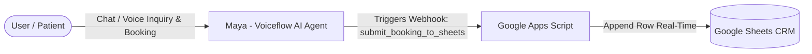

# OmniHealth AI — Voice & Chat Patient Concierge

OmniHealth AI is a 24/7 autonomous patient concierge and intake assistant. It helps prospective patients inquire about medical packages, upfront pricing, and doctor availability in Bangkok and Istanbul, while capturing consultation bookings directly into Google Sheets in real time.

🌐 **Live Website:** [https://omnihealth-ai-id.vercel.app](https://omnihealth-ai-id.vercel.app)  
📁 **Repository:** [https://github.com/yusufarifin100/omnihealth-ai](https://github.com/yusufarifin100/omnihealth-ai)

---

## 🔄 System Flowchart

---

## 💻 Tech Stack
* **Conversational AI / Voice Engine:** Voiceflow (Agentic Architecture, Tool Calling, Deepgram STT, ElevenLabs TTS)
* **LLM Engine:** Voiceflow Flash 4.2 / OpenAI GPT-4o-mini
* **Frontend:** Vanilla HTML5, CSS3, Vanilla JS
* **Cloud Hosting:** Vercel
* **Automation & CRM Integration:** Google Apps Script, Google Sheets
* **API & Backend Specifications:** FastAPI (`webhooks/server.py`), JSON Schemas (`webhooks/sample_payload.json`)
