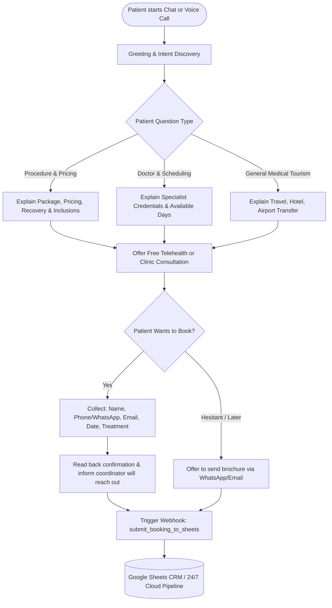

# OmniHealth AI — Voice & Chat Patient Concierge

OmniHealth AI is an autonomous 24/7 patient concierge and intake assistant engineered for international healthcare and medical tourism networks (modeled after the **PlacidWay** global coordination standard). It consults prospective international patients on procedure packages, upfront price estimates, surgeon credentials, and travel logistics, capturing consultation bookings directly into a real-time CRM coordination pipeline across accredited hospital partner clinics in Bangkok and Istanbul.

🌐 **Live Production Portal:** [https://omnihealth-ai-id.vercel.app](https://omnihealth-ai-id.vercel.app)  
📁 **Repository:** [https://github.com/yusufarifin100/omnihealth-ai](https://github.com/yusufarifin100/omnihealth-ai)

---

## 🎯 Purpose & Business Impact
International medical tourism requires prompt qualification: patients considering dental smile makeovers, LASIK, or executive health screenings in foreign destinations often drop out due to 48–72 hour email response delays. OmniHealth AI provides:
* **Instant 24/7 Multi-Channel Intake:** Voice (Speech-to-Text & Neural TTS) and interactive Chat widgets on web.
* **Grounded Clinical Knowledge (Zero Hallucination):** Pre-programmed medical packages ($4,200-$4,800 Dental Veneers, $1,650 LASIK, $450 Executive Health Checkup).
* **Automated Lead Capture:** Automatically captures patient name, email, phone/WhatsApp, chosen procedure, destination, and preferred appointment dates into CRM workflows for human medical coordinators.

---

## 🔄 Conversation & System Flowchart

---

## 💻 Tech Stack
* **Conversational AI / Voice Engine:** Voiceflow (Agentic Architecture, Tool Calling, Deepgram STT, ElevenLabs TTS)
* **LLM Engine:** Voiceflow Flash 4.2 / OpenAI GPT-4o-mini
* **Frontend:** Vanilla HTML5, CSS3 (Modern Glassmorphic Healthcare Design), Vanilla JS
* **Cloud Hosting:** Vercel (Auto-deploy on Git push via Edge CDN)
* **Automation & CRM Integration:** Google Apps Script Serverless Webhooks, Google Sheets 24/7 Cloud Pipeline, n8n / Make.com Webhook Specification
* **API & Backend Specifications:** FastAPI (`webhooks/server.py`), JSON Schemas (`webhooks/sample_payload.json`)

---
*Created by [Ahmad Yusuf Arifin](https://github.com/yusufarifin100) for PlacidWay AI Medical Tourism Intake Assistant.*
